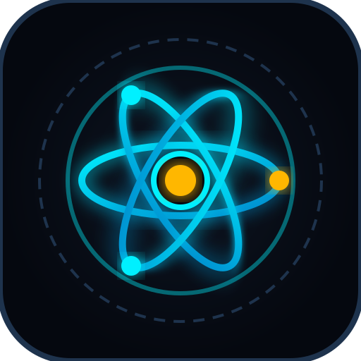

# Once Human - Master Codex & Recipe Matrix 🌐

Moderní, bleskově rychlá webová aplikace a kompletní komunitní databáze pro hru **Once Human**. Poskytuje přehled všech herních receptů, interaktivní kalkulátor archetypů masa (Chef Matrix), technologie, chemovídu a taktické vynálezy napříč všemi herními scénáři.



---

## ✨ Klíčové funkce

- 🍽️ **Discovered Cooking (Objevené recepty)**:
  - Kompletní recepty pro vaření ze světa (Core, The Way of Winter, Manibus, Prismverse).
  - Přehled nutričních hodnot (Energy, Hydration), délky trvání a přesných efektů buffů.
- 🧪 **Chef Matrix (Volné vaření a archetypy)**:
  - Simulátor kombinací surovin: Maso (Archetypy jako Shrapnel, Burn, Fast Gunner, Frost Vortex, Shock) + Plodiny + Koření + Zesilovače (Stardust Source, Máslo, Sýr).
- 💊 **Medicine & Fermentation**:
  - Výroba aktivátorů, séra, kvašení kyseliny v sudech a pokročilá medicína.
- ⚙️ **Tech Inventions & Weapons**:
  - Vynálezy z Memetics stromu, drony, taktické granáty, munice a zbraně.
- 🔗 **Interaktivní cross-linky surovin**:
  - Kliknutí na vyrobitelnou surovinu (např. Čistá filtrovaná voda, Kyselina, Střelný prach) okamžitě otevře její recept s možností vrátit se zpět přes breadcrumb historii.
- ⭐ **Oblíbené recepty (Pinning)**:
  - Ukládání receptů do oblíbených hvězdičkou a rychlé filtrování jedním kliknutím. Uloženo lokálně v prohlížeči.
- 🔍 **Bleskové vyhledávání**:
  - Předpočítaný vyhledávací index s debounce (120 ms). Vyhledává v názvech (CZ/EN), surovinách, popisech i efektech buffů.
  - Klávesová zkratka `/` pro okamžité zaměření do vyhledávání.
- 🔗 **Deep Linking & Sdílení**:
  - Každý recept i záložka má unikátní URL hash (např. `#recipe/b-01`, `#tab=medicine`), který můžete přímo zkopírovat a poslat spoluhráčům.
- 📱 **PWA & Plná Offline podpora**:
  - Nainstalujte si Codex jako samostatnou aplikaci do Windows nebo mobilu. Díky Service Workeru funguje i zcela bez připojení k internetu.
- 🇨🇿 / 🇬🇧 **Plná lokalizace (CZ/EN)**:
  - Kompletní překlad všech herních termínů, surovin a efektů.

---

## 🚀 Jak spustit lokálně

Aplikace nevyžaduje žádný těžký backend, běží jako čistý statický web:

1. Klonujte repozitář:
   ```bash
   git clone https://github.com/bandaska-cz/Once-Human-Codex.git
   cd Once-Human-Codex
   ```
2. Otevřete soubor `index.html` v libovolném moderním webovém prohlížeči (nebo spusťte lokální server, např. přes rozšíření Live Server ve VS Code, `npx serve` nebo `python -m http.server 8000`).

---

## 🛠️ Použité technologie & Architektura

- **HTML5 & Vanilla JavaScript (ES6+)**: Žádné těžké frontendové frameworky, nulový runtime overhead.
- **Tailwind CSS (Předkompilovaný build)**: Statický, minifikovaný CSS bundle bez zátěže runtime CDN.
- **Modern Web Guidance**:
  - Odložené vykreslování DOMu mimo viewport (`content-visibility: auto` + `contain-intrinsic-size`).
  - Dávkový zápis do DOMu přes `DocumentFragment`.
- **Progressive Web App (PWA)**:
  - Vlastní Service Worker (`sw.js`) s Cache First strategií.
  - Vektorové ikony v SVG.

---

## ⚖️ Právní informace

Tento projekt je nezávislá komunitní fanouškovská tvorba. Veškeré herní ochranné známky, názvy, loga a materiály jsou majetkem společnosti **Starry Studio / NetEase Games**.

